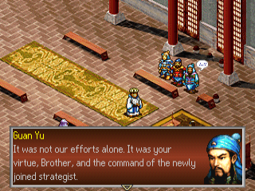
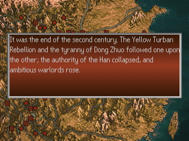
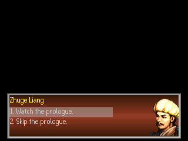
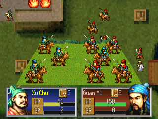
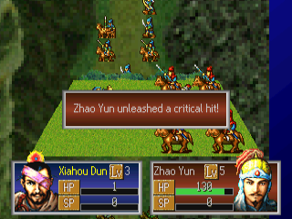
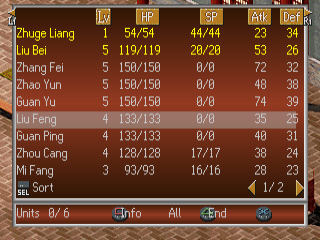
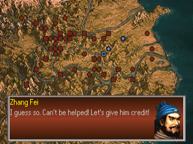
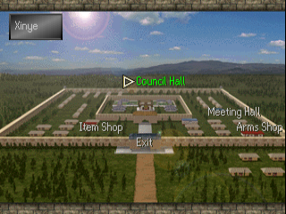
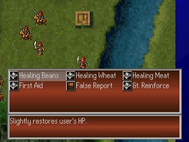

# Sangokushi Koumeiden — English Translation

A fan translation of **Sangokushi Koumeiden** (三國志孔明伝, Koei) for the PlayStation into
English. It is the sequel to *Sangokushi Eiketsuden*: a story-driven tactics game in which you
follow Zhuge Liang (Kongming) from his first days in Liu Bei's service, through Chibi and the
founding of Shu, to the northern campaigns, with hex-map battles, councils, towns and shops in
between. The game was only released in Japan.

> **This is a full machine translation.** All of the game's text was translated from
> Japanese by an AI model, not by a human translator, and it has not been
> proofread by a fluent Japanese speaker. Expect occasional mistranslations, awkward
> phrasing and inconsistent terms. Corrections are welcome.

> **This is a beta.** All of the game's text is in English, but only the opening of the game
> (the prologue, Xinye, the Bowang battle and the start of the Xinye fire battle) has been played
> in order. A few later scenes were only checked by jumping to them. Expect some text that is
> squeezed, cut short or wrapped oddly later on.

This repository contains the English text and the tools that build the patch.
It does **not** contain the game, any of its data, or the Japanese script — you need
your own copy of the game.

## Screenshots

| | | |
|:-:|:-:|:-:|
|  |  |  |
| Event dialogue | Narration | Choices |
|  |  |  |
| Battle | Battle messages | Choosing units for a battle |
|  |  |  |
| World map | Town | Items |

## What's translated

- All event text: every chapter's dialogue, narration, scene captions and choices
- Town people's lines and the officers' retreat lines in battle
- Officer, unit type, item and strategy names and descriptions, place and battle names
- Menus, battle messages, map commentary, shop, save and memory card messages
- Graphics: the stat plates and both settings screens, drawn at build time with an original
  English font
- A proportional English font (original drawings) with word wrap and paging

Long labels are shortened where the game's boxes are too small.

## Applying the patch (players)

You need:

- **Your own copy of the Japanese disc as a disc image** (serial `SLPS-00688`): two `.bin` files
  (Track 1 and Track 2) and a `.cue` file. The patch does not contain the game.
- **A patching program.** [Delta Patcher](https://github.com/marco-calautti/DeltaPatcher) is
  free and needs no installation.
- **A PlayStation emulator.** The patch was tested in [DuckStation](https://www.duckstation.org/).

Steps:

1. **Download the patch.** Get `Sangokushi_Koumeiden_English_v<version>.zip` from the
   [Releases page](https://github.com/damon-daemon/sangokushi-koumeiden-english/releases) and
   unzip it. Inside are the patch (`.xdelta`), a `.cue` file and a README.txt.
2. **Copy Track 1.** Make a copy of your Track 1 `.bin` file and give the copy exactly this
   name, with the version number of the zip you downloaded (for example `v0.9.4`):

   `Sangokushi Koumeiden (English v<version>) (Track 1).bin`

   Keep the original file as it is.
3. **Patch the copy.** Open Delta Patcher. Under **Original file** choose the copy you just
   made, under **XDelta patch** choose the `.xdelta` file from the zip, and click
   **Apply patch**.

   If it reports a checksum error, your disc image is not the one the patch was made for:
   compare it with the table below.
4. **Check the name of Track 2.** It must be named exactly
   `Sangokushi Koumeiden (Japan) (Track 2).bin`. Rename it if yours is named differently.
   Track 2 is the game's CD audio and is not changed.
5. **Put three files in one folder:** the patched Track 1, Track 2, and
   `Sangokushi Koumeiden (English v<version>).cue` from the zip.
6. **Play.** Open that `.cue` file in your emulator.

If the emulator says it cannot find a file, a name in step 2 or 4 does not match exactly.

### Is my disc image the right one?

The patch fits an unmodified image of the Japanese disc. Track 1 must match:

| Track 1 | |
|---|---|
| Size  | 678,086,304 bytes |
| CRC32 | `33EAE625` |
| MD5   | `b49f73f3fe4936d58fb5a9adb99b1306` |
| SHA-1 | `db5e32a8b879924862e72e3337be2c710da687e2` |

Track 2 is 37,810,752 bytes, CRC32 `40E86050`.

### Command line

Instead of Delta Patcher (steps 2 and 3) you can use `xdelta3`:

```
xdelta3 -d -s "Sangokushi Koumeiden (Japan) (Track 1).bin" sangokushi_koumeiden_en_v<version>.xdelta "Sangokushi Koumeiden (English v<version>) (Track 1).bin"
```

## Building from source

Requirements: Python 3.10+, `xdelta3` (for the patch file).

```
python -m venv .venv
.venv/bin/pip install -r requirements.txt
cp "/path/to/Sangokushi Koumeiden (Japan) (Track 1).bin" sangokushi_koumeiden_track1.bin
cp "/path/to/Sangokushi Koumeiden (Japan) (Track 2).bin" sangokushi_koumeiden_track2.bin
.venv/bin/python tools/setup.py      # checks the disc, extracts script/ from it
.venv/bin/python tools/build.py      # writes build/sangokushi_koumeiden_en_track1.bin (+ track 2, .cue) and the .xdelta
```

`script/`, `extract/` and `build/` hold data from your disc and are never committed.
`.venv/bin/python tools/package.py <version>` then writes the release zip to `release/`.
No disc data is ever packaged.

## Repository layout

| Path | Contents |
|---|---|
| `tl/snr/` | English for the chapter text `SNR/SNR*M.E2`, by part and entry number |
| `tl/ip/`, `tl/dmes/` | English for the town people's lines `SNR/IP.E2` and the retreat lines `SNR/DMES.E2` |
| `tl/names/` | Speaker, place, item, NPC label and battle names |
| `tl/progstr/` | English for strings in the game program, by address |
| `tools/setup.py`, `tools/build.py` | Check the disc and extract; build the patched disc and the patch |
| `tools/tl.py`, `tools/text.py` | Translation checks, wrapping and paging |
| `tools/snr.py`, `tools/ip.py`, `tools/dmes.py` | Chapter text, town lines and retreat line file formats |
| `tools/iso.py` | Disc image |
| `tools/names.py`, `tools/tokens.py` | Speaker names; name tokens for officers, items, places and labels |
| `tools/progstr.py`, `tools/fmtlimit.py` | Program strings; format-string limits |
| `tools/vwf.py`, `tools/pixfont.py`, `tools/asm.py` | Proportional font, layout patches; small MIPS assembler |
| `tools/gfx.py` | Redrawn label graphics and settings screens |
| `tools/package.py` | Makes the release zip |
| `tools/dev/`, `tools/emu/` | Development helpers (disassembly, DuckStation automation) |
| `docs/screenshots/` | README screenshots |

## HD texture pack (optional)

For DuckStation there is a separate, optional
[HD texture pack builder](https://github.com/damon-daemon/sangokushi-koumeiden-hd-textures): it
shows the higher-resolution art of the game's Windows 95 release in the PlayStation game. It
needs your own Windows 95 disc and this patch v0.9.4 or later.

## Known issues

- The title logo, the loading screen art, the Koei slogan logo and the movies are unchanged.
- The gold plate reads "G" because the plate is too small.
- Item names are shortened to fit the item list (e.g. "Repeating Xbow"); dialogue may use the
  full names.
- Most of the game after the first battles has not been seen in play. Its text may overflow in
  places.

Tested in DuckStation only. Bug reports with a screenshot and where it happened are welcome.

## Credits

- Translation and hacking: [damon-daemon](https://github.com/damon-daemon)
- Sangokushi Koumeiden © Koei Tecmo. This is an unofficial fan project, not affiliated with
  or endorsed by Koei Tecmo. Please support the official releases.

## License

The tools, fonts, documentation and English translation text in this repository
are released under the [MIT License](LICENSE). This covers only original work in
this repository: the game itself and all of its content (code, Japanese text,
graphics, audio) are copyright Koei Tecmo and are not included or licensed here.
